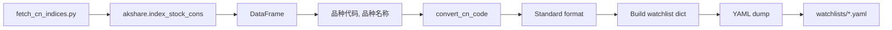

# Design: A-Share Index Constituents Watchlist Generation

**Date:** 2026-05-05
**Status:** Draft
**Approach:** Minimal implementation (方案A)

## Overview

Add functionality to fetch CSI 500 (中证500) and ChiNext Index (创业板指) constituent stocks from akshare, generate watchlist YAML files in the same format as existing US indices.

## Goals

1. Create `fetch_cn_indices.py` to fetch A-share index constituents
2. Generate two watchlist YAML files:
   - `watchlists/zhongzheng_500.yaml` (CSI 500 constituents)
   - `watchlists/chuangyeban.yaml` (ChiNext constituents)
3. Follow existing code patterns from `fetch_indices.py`
4. Ensure stock codes use SH/SZ suffix convention

## Non-Goals

- Unified index fetching infrastructure (future refactoring)
- Real-time index constituent updates (manual execution only)
- Web UI integration for index management
- Support for other A-share indices (scalable but out of scope)

## Architecture

### File Structure

```
src/quantflow/data/
├── fetch_indices.py         # US indices (existing)
├── fetch_cn_indices.py     # A-share indices (NEW)
├── adapters/
│   └── akshare.py           # akshare adapter (existing)
└── ...

watchlists/
├── sp_500.yaml              # S&P 500 (existing)
├── nasdaq_100.yaml          # Nasdaq 100 (existing)
├── djia.yaml                # DJIA (existing)
├── zhongzheng_500.yaml      # CSI 500 (NEW)
└── chuangyeban.yaml         # ChiNext (NEW)
```

### Component Design

#### 1. CN_INDICES Configuration

```python
CN_INDICES = {
    "中证500": {
        "symbol": "000905",
        "name": "CSI 500",
        "filename": "zhongzheng_500.yaml"
    },
    "创业板指": {
        "symbol": "399006",
        "name": "ChiNext",
        "filename": "chuangyeban.yaml"
    }
}
```

**Rationale:**
- Matches `INDICES` structure in `fetch_indices.py`
- Uses Chinese index names as keys for clarity
- Includes English name for watchlist description

#### 2. Stock Code Conversion

```python
def convert_cn_code(code: str) -> str:
    """Convert A-share code to standard format.
    
    Rules:
    - 6xxxxx → SH (Shanghai Stock Exchange)
    - 0xxxxx → SZ (Shenzhen Stock Exchange)
    - 3xxxxx → SZ (ChiNext board on Shenzhen)
    
    Args:
        code: Raw stock code from akshare (e.g., "600000")
    
    Returns:
        Standard format code (e.g., "600000.SH")
    """
    if not code or not code.isdigit():
        return ""
    
    if code.startswith("6"):
        return f"{code}.SH"
    elif code.startswith(("0", "3")):
        return f"{code}.SZ"
    else:
        # Fallback to SZ for unknown patterns
        return f"{code}.SZ"
```

**Edge Cases:**
- Empty string → return empty (filtered out)
- Non-digit characters → return empty (filtered out)
- Unknown prefix (1, 2, 4, 5, 7, 8, 9) → default to SZ (conservative)

#### 3. fetch_cn_index() Function

```python
def fetch_cn_index(
    index_name: str,
    symbol: str,
    en_name: str,
    filename: str
) -> None:
    """Fetch A-share index constituents and save to YAML.
    
    Workflow:
    1. Call akshare.index_stock_cons(symbol)
    2. Extract columns: 品种代码, 品种名称
    3. Convert codes to SH/SZ format
    4. Build watchlist dict
    5. Write to watchlists/{filename}
    
    Args:
        index_name: Chinese name (e.g., "中证500")
        symbol: Index code (e.g., "000905")
        en_name: English name (e.g., "CSI 500")
        filename: Output YAML filename
    """
    import akshare as ak
    
    logger.info(f"Fetching {index_name} constituents...")
    
    try:
        df = ak.index_stock_cons(symbol=symbol)
        
        # Expected columns: 品种代码, 品种名称
        df = df[["品种代码", "品种名称"]].copy()
        df.columns = ["code", "name"]
        
        # Convert codes
        df["code"] = df["code"].apply(convert_cn_code)
        df = df[df["code"] != ""].drop_duplicates(subset=["code"])
        
        # Build watchlist
        watchlist = {
            "name": f"{index_name}_Components",
            "description": f"Auto-generated {en_name} ({index_name}) constituents from akshare",
            "items": [
                {
                    "code": row["code"],
                    "name": row["name"],
                    "tags": [index_name]
                }
                for _, row in df.iterrows()
            ]
        }
        
        # Write YAML
        project_root = Path(__file__).parent.parent.parent.parent
        filepath = project_root / "watchlists" / filename
        
        with open(filepath, "w") as f:
            yaml.dump(watchlist, f, sort_keys=False, allow_unicode=True)
        
        logger.info(f"Saved {len(df)} stocks to {filepath}")
        
    except Exception as e:
        logger.error(f"Failed to fetch {index_name}: {e}")
```

#### 4. Main Execution

```python
if __name__ == "__main__":
    for cn_name, config in CN_INDICES.items():
        fetch_cn_index(
            index_name=cn_name,
            symbol=config["symbol"],
            en_name=config["name"],
            filename=config["filename"]
        )
```

## Data Flow



## Error Handling

| Error Type | Handling | Log Level |
|------------|----------|-----------|
| Network error (akshare) | Catch exception, log, skip | ERROR |
| Empty DataFrame | Return early, skip YAML write | WARNING |
| Invalid code format | Filter out with empty string | DEBUG |
| File write error | Catch exception, log | ERROR |

## Testing Strategy

### Unit Tests (tests/data/test_fetch_cn_indices.py)

1. **convert_cn_code() logic:**
   - 6xxxxx → SH suffix
   - 0xxxxx → SZ suffix
   - 3xxxxx → SZ suffix
   - Empty string → ""
   - Non-digit → ""

2. **CN_INDICES structure:**
   - Required keys exist
   - Filename has .yaml extension
   - Symbol is numeric string

3. **YAML output format:**
   - Mock DataFrame, verify watchlist structure
   - Verify tags field contains index name

### Integration Tests (optional, marked @pytest.mark.integration)

1. **Real API call:**
   - Fetch CSI 500 constituents
   - Verify non-empty result
   - Verify code format

## Implementation Checklist

- [ ] Create `src/quantflow/data/fetch_cn_indices.py`
- [ ] Implement `convert_cn_code()` function
- [ ] Implement `fetch_cn_index()` function
- [ ] Add `CN_INDICES` configuration
- [ ] Add main execution block
- [ ] Create unit tests in `tests/data/test_fetch_cn_indices.py`
- [ ] Run tests: `pytest tests/data/test_fetch_cn_indices.py -v`
- [ ] Manual test: `python -m quantflow.data.fetch_cn_indices`
- [ ] Verify generated YAML files in `watchlists/`

## Success Criteria

1. Running `python -m quantflow.data.fetch_cn_indices` creates:
   - `watchlists/zhongzheng_500.yaml` with CSI 500 constituents
   - `watchlists/chuangyeban.yaml` with ChiNext constituents

2. YAML format matches existing watchlists:
   ```yaml
   name: 中证500_Components
   description: Auto-generated CSI 500 (中证500) constituents from akshare
   items:
   - code: 600000.SH
     name: 浦发银行
     tags:
     - 中证500
   ```

3. All unit tests pass
4. Code style passes ruff linting

## Rollout Plan

1. Implement and test locally
2. Commit with message: "feat(data): add A-share index constituent fetcher"
3. No web UI changes needed
4. No config changes needed
5. Documentation: Update AGENTS.md with new file reference

## Future Enhancements (Out of Scope)

- Unified index fetching infrastructure
- Support for more A-share indices (上证50, 沪深300, etc.)
- Scheduled auto-updates
- Web UI for manual refresh